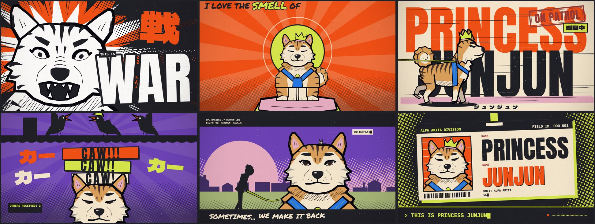

# Princess Jun Jun — "Operation Walkies"

[](https://www.youtube.com/watch?v=qZUAuDjw7VI)

**▶ [Watch the film on YouTube](https://www.youtube.com/watch?v=qZUAuDjw7VI)**

A hand-drawn animated music video, drawn in code with p5.js and p5.brush and rendered frame by frame in headless
Chrome. It looks like an underground anime concert poster starring one extremely judgmental Akita.

- [STORYBOARD.md](STORYBOARD.md): the concept, the measured song map, and the shot list.
- [ANIMATION_GUIDE.md](ANIMATION_GUIDE.md): the art direction rules and the drawing API.

Every frame of the film is drawn by the code in this repo. Six of them:



## What's here

| Path | What it is |
|---|---|
| `assets/` | The song, the lyrics, the whisper transcript, the Jun Jun reference photos, the type style reference |
| `tools/analyze.py` | Measures the song (tempo, beats, downbeats, energy) and writes `src/songmap.js` |
| `tools/lipsync.py` | Separates the voice in the sung bridge and measures its syllables; writes `src/lipsync.js` for Jun Jun's mouth |
| `src/core.js` | Palette, musical time, camera, the brush paint wrapper, the 2D graphic layer, compositing |
| `src/type.js` | The typography system: hero / hand / mono / Japanese, slams, labels, stamps |
| `src/fx.js` | The signature effects: stare, impact frame, rage aura, vibration lines, brush wipe, annotations |
| `src/junjun.js` | Princess Jun Jun: front bust, regal sit, profile stand and walk, expressions |
| `src/cast.js` | The Commander, the Yorkie, squirrels, cat, crows, hydrant, pup, props |
| `src/timeline.js` | Chapter registry and chapter-break wipes |
| `src/ch/` | The nine chapters, one file each |
| `src/scenes_test.js` | Standalone test scenes (brushes, poses, cast, style, fx) |
| `src/reel.js` | The tall Instagram trailer (1080 × 1920): bars 14-19 redrawn for a tall frame, plus a "watch on YouTube" card |
| `studio.html` | The page every frame is drawn in. Open it in Chrome to scrub the film (`?t=45&scene=poses`) |
| `render.mjs` | Renders contact sheets, stills, clips and the full film |
| `docs/` | The poster and the frame grid shown in this README |

## Rendering

You need Node.js 22.12 or newer, Google Chrome and ffmpeg. `tools/analyze.py` needs `uv` (only if you change the song).

```bash
npm install
node render.mjs --frames=0:204.72 --workers=6      # draw every frame into out/frames (resumable)
node render.mjs --encode                           # join the frames and the song → out/princess-junjun.mp4
```

Quick checks while you work:

```bash
node render.mjs --sheet=44.8,45.8,46.6,47.6 --cols=4 --w=640 --out=out/check/chorus.jpg   # contact sheet
node render.mjs --stills=41.3 --jpg --out=out/check/full                                   # one full-size frame
node render.mjs --clip=44.74:55.34 --out=out/chorus1.mp4                                   # a clip with sound
node render.mjs --scene=poses --sheet=0,1,2,3 --cols=2 --w=960 --out=out/check/poses.jpg  # Jun Jun pose sheet
```

The Instagram trailer (21 s, 1080 × 1920, sound fades out at the end):

```bash
node render.mjs --fmt=v --scene=reel --clip=39.416:60.639 --fade=.03:1.6 --workers=6 --out=out/junjun-reel.mp4
```

`--fmt=v` switches the whole engine to the tall frame; open `studio.html?fmt=v&scene=reel&t=45` to scrub it.

If Chrome is not at the default macOS path, add `--chrome=<path to chrome>`.

Every frame is a pure function of its timestamp, so frames can render in any order and in parallel, and a re-render
gives the same picture.

## License

The code is [MIT](LICENSE). The song, the lyrics, the Jun Jun photos and the poster are not: all rights reserved.
